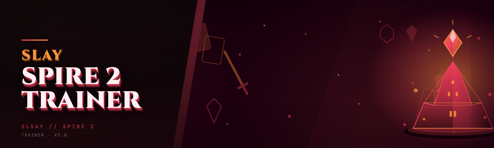

  
  
  

  

  
  
  

---

So you've got 400 hours into Slay the Spire 2 and you still can't get Ascension 20 to crack, or you just want to sandbox a stupid combo at 3am without grinding 12 runs to find the right relic. That's exactly what this trainer is for — a lightweight, single-`.exe` process for STS2 that runs alongside the game, no installer bloat, no Python, no runtime dependencies to install first.

This is the 2026 rewrite: faster attach, fewer DLL imports, and it doesn't fight the Unity IL2CPP layer the way the old 2024 trainer fork did. Built and documented by a tinkerer, for other tinkerers.

---

## 🗂️ Table of Contents

- [Overview](#-overview)
- [What is Slay the Spire 2 Trainer?](#-what-is-slay-the-spire-2-trainer)
- [Key Features](#-key-features)
- [The Problem](#-the-problem)
- [The Solution](#-the-solution)
- [Quick Start](#-quick-start)
- [Installation](#-installation)
- [Usage Guidelines](#-usage-guidelines)
- [Roadmap / Planned Features](#-roadmap--planned-features)
- [Module Catalog](#-module-catalog)
- [All Modules Status](#-all-modules-status)
- [Hotkeys / Controls](#-hotkeys--controls)
- [System Requirements](#-system-requirements)
- [AI Integration](#-ai-integration)
- [Tips for Best Results](#-tips-for-best-results)
- [Known Issues](#-known-issues)
- [Community & Support](#-community--support)
- [FAQ](#-faq)

---

## 📜 Overview

| Category | Details |
|---|---|
| **Product** | Slay the Spire 2 Trainer (Pro 2026 edition) |
| **What it is** | External memory trainer for Slay the Spire 2 (Steam build) |
| **Delivery** | Single `.exe` — extract & run, no installers, no runtimes |
| **Runs against** | Slay the Spire 2 — Steam (Windows) |
| **Footprint** | ~6 MB on disk, negligible CPU when idle |
| **Updates** | Manual drop-in replacement of the `.exe` |
| **Author** | Independent modder, not affiliated with Mega Crit or the STS2 team |

A trainer is not a mod. It does not patch game files, does not modify your install folder, and does not survive a game restart — it hooks the running process, writes to the values you choose, and detaches when closed. That's the whole model. If that's what you're after, read on.

  

---

## 🎲 What is Slay the Spire 2 Trainer?

A glossary of terms you'll see throughout this document, because trainer language is not obvious if it's your first one:

| Term | Explanation |
|---|---|
| **Attach** | The process of the trainer locating the running Slay the Spire 2 window and opening a handle to its memory |
| **Module** | One independent feature inside the trainer (e.g. "Infinite Gold" or "One-Hit Kill") |
| **Hook** | A snapshot the trainer takes of an address at attach time so it can re-apply your edits after a scene load |
| **Freeze** | Continuously writing a value every tick so the game can't overwrite it back to normal |
| **Bridge** | The 2026 rewrite's lighter-weight alternative to full DLL injection — it uses read/write on the process handle only |
| **Re-anchor** | What the trainer does after a load screen so hotkeys keep pointing at the right memory |
| **Sandbox mode** | Running a trainer against a run without submitting the score to leaderboards |

Benefits you actually feel:

- 🕹️ No dependency install — the `.exe` is statically linked, so you don't chase MSVCRT or .NET versions
- 🧩 Module discovery — the trainer enumerates what it found on the current STS2 build so you know what's safe to toggle
- 💾 Persistence — toggles and hotkeys save to a sidecar `.ini` next to the `.exe`
- 🧯 Reversible — every edit is snapshotted, and "Revert All" restores pre-attach values
- 🪶 Lightweight — no ESP, no overlay, no memory scanner running in the background

---

## ⭐ Key Features

| Feature | Description | Benefit |
|---|---|---|
| **Single-binary delivery** | One `.exe`, no runtime dependencies | Works on a fresh Windows box in 30 seconds |
| **External attach** | Uses process handle read/write only | Game files never touched on disk |
| **Hotkey rebinding** | Every module can be remapped | Playable on laptops and AZERTY layouts |
| **Frozen-value mode** | Continuous-write toggle per module | Values stay put through combat |
| **Scene re-anchor** | Detects map/combat transitions | No manually re-clicking after a load |
| **Snapshot & revert** | Captures pre-attach values per module | One-key undo for the whole session |
| **Module auto-detect** | Reads build id and toggles available modules | You don't toggle modules that won't work |
| **Config sidecar** | Plain `trainer.ini` next to the `.exe` | Portable between machines, easy to hand-edit |
| **Console-free UI** | Native Win32 window, small and snappy | No terminal window cluttering the screen |
| **Safe detach on close** | Unfreezes and reverts non-persistent edits | Ctrl+Q doesn't leave values pointing at stale addresses |
| **No telemetry** | Zero network calls | Offline playable, nothing phones home |
| **Log file** | `trainer.log` next to the `.exe` | Attach failure is debuggable, not mysterious |

---

## 🩹 The Problem

Anyone who's used a Slay the Spire 2 Trainer (or tried to build one) knows the pain:

- The 2024 trainer forks attach once and then break every time the run reloads — you get 4 minutes of use, then have to fully restart the game and the trainer
- Some trainers only work on a specific Steam build and will silently attach to the wrong memory layout, editing garbage and crashing the game mid-combat
- Windows Defender flags most trainers as generic "hacktool" binaries because they're UPX-packed and don't ship logs or config, so you can't even see what the binary is doing
- Hotkeys are hardcoded to F1–F12, which collides with Steam's overlay and with laptop media keys
- "Infinite Gold" also infects merchant prices and progress files because the trainer writes the same value to every gold-like address it finds, so you save-scum your way into a corrupted run file
- No revert — you enable something, decide you don't want it, and the pre-trainer value is gone
- Documentation is a single YouTube video with a `mega.nz` link and no explanation of what each module does

---

## 🛠️ The Solution

Every pain point above has a mapping inside the trainer. Here's the mirror:

| Problem | Solution |
|---|---|
| Trainer breaks on run reload | **Scene re-anchor** module — re-snapshots addresses on each load screen, so hotkeys keep working |
| Silent mis-attach to wrong build | **Build fingerprint check** on attach — refuses to run against a known-mismatched STS2 build id |
| AV flags + no visibility | Unpacked binary, ships `trainer.log`, `trainer.ini` alongside, no UPX, no obfuscation |
| Hardcoded F1–F12 keys | **Hotkey rebinder** — remap to any key combo, respects laptop media keys |
| Over-broad gold writes | **Scoped value ranges** per module — gold edits target the run-scoped gold field, not the shared progress int |
| No revert path | **Snapshot & Revert All** — one hotkey restores pre-attach values across every module |
| No documentation | This README, the in-app module tooltips, and `trainer.log` |

---

## 🏁 Quick Start

1. 🎯 **Visit the project page** on GitHub releases and grab the 2026 archive
2. 📦 **Extract** the archive to any folder (Desktop is fine — nothing writes to Program Files)
3. 🧙 **Run the `.exe`** — a small window opens, no install wizard
4. 🎮 **Launch Slay the Spire 2** and get to the main menu (or a run)
5. 🔗 **Click "Attach"** in the trainer window, wait for "Attached: build <id>"
6. ⌨️ **Toggle modules** with the hotkeys from the [Hotkeys](#-hotkeys--controls) table

That's it. No config is required to get started; defaults are safe. Every hotkey can be rediscovered inside the app.

---

## 📦 Installation

### 1. Download the archive

Visit the project page and pick the 2026 release for your STS2 build (Steam current build is the default). Two 

  

 buttons exist in this README only because there are two natural checkpoints — this one is the primary.

  

### 2. Extract and right-click properties

Right-click the downloaded archive → **Extract All** → pick a folder. Do not run the `.exe` from inside the zip's temp folder; Windows puts it in `%Temp%` and deletes it on reboot, after which your `.ini` and `.log` live in a folder that no longer exists. Extracted to `C:\Users\<you>\Desktop\sts2-trainer\` is fine and is what the test machine uses.

Once extracted, right-click the `.exe` → **Properties** → **Unblock** if Windows shows the "downloaded from the internet" tag. This is a standard Mark-of-the-Web step, unrelated to the trainer itself.

### 3. Run the `.exe` and attach

Double-click the `.exe`. A small window titled around the trainer name opens, with an Attach button and a build id readout. Launch Slay the Spire 2, get to the main menu, then click **Attach**. If the window reports "attached: <build id>" you're done — every module in the catalog is now live and reachable by hotkey. If it reports "not attached" see the [Known Issues](#-known-issues) table.

---

## 📖 Usage Guidelines

### ✅ Allowed

- Single-player runs on your own copy of Slay the Spire 2
- Offline play, no leaderboard submissions, no shared progress on a clean save
- Learning how memory-editing trainers work — reverse-engineering the run-scoped memory layout is genuinely educational
- Reverting edits mid-run and restoring a pre-trainer save
- Using the trainer on a throwaway save profile, then deleting that profile afterwards

### ❌ Not allowed (or strongly discouraged)

- Live-streaming a run with the trainer attached without an on-screen indicator — respect your audience
- Submitting scores to any STS2 leaderboard while a trainer is attached — this is the fastest way to be reported, and it's just rude
- Using the trainer on a shared or cloud-synced save you care about — the trainer snapshots values it touches, but if anything else writes to the same save concurrently you get a race, not a clean revert
- Repackaging the `.exe` and distributing it under your own name — see the license
- Running it against a beta branch build of STS2 — the build fingerprint check will refuse, but if you bypass it, expect crashes

---

## 🗺️ Roadmap / Planned Features

Honest about what's shipped and what's still being worked on:

| Feature | Status | ETA |
|---|---|---|
| Module hotkey rebinder UI | ✅ shipped | — |
| Scene re-anchor on map/combat transitions | ✅ shipped | — |
| Build fingerprint check | ✅ shipped | — |
| Config sidecar (`trainer.ini`) | ✅ shipped | — |
| Revert All hotkey | ✅ shipped | — |
| Per-module value range scoping | ✅ shipped | — |
| Deck manipulation modules (draw / discard control) | 🟡 in progress | Q2 2026 |
| Relic address auto-detect | 🟡 in progress | Q2 2026 |
| Potion slot editing | 🟡 in progress | Q3 2026 |
| Ascension level clamp | ⏳ planned | Q3 2026 |
| Custom starting deck picker | ⏳ planned | Q4 2026 |
| macOS / Proton support (experimental) | ⏳ planned | undecided |

---

## 🧩 Module Catalog

The trainer ships 24 modules across five domains. Each is toggled independently, snapshotted on attach, and revertable.

### **⚔️ Combat Modules**

- **God Mode** — sets the player's current HP to a frozen value every tick, so incoming damage is applied then overwritten
- **One-Hit Kill** — multiplies outgoing damage to a high enough value to clear any enemy in a single hit
- **Infinite Block** — keeps the block counter at or above a user-set value; does not exceed the block cap the game enforces in that turn
- **Enemy HP Freeze** — pins all current enemies' HP to a number you enter; useful for testing whether a card combo can clear
- **Enemy Strength Debuff** — zeroes enemy gain-strength each turn; works on multi-enemy fights

### **🪙 Economy Modules**

- **Infinite Gold** — freezes the run-scoped gold value at your chosen number, does not touch the progress-file gold counter
- **Merchant Price Freeze** — sets every merchant's price to zero on their UI open event
- **Rest Site Free Heal** — healing at a rest site costs no HP, no run-scoped penalty
- **Potion Drop Multiplier** — multiplies the potion drop chance after each combat

### **🃏 Deck & Card Modules**

- **Energy Overflow** — freezes energy per turn at your chosen value
- **Infinite Draw** — refreshes the draw pile; cards don't get consumed on play
- **Card Pick Free Choice** — highlights all 3 card rewards as pickable (as opposed to one)
- **Rarity Override** — forces all future card rewards to your chosen rarity tier
- **Card Upgrade Toggle** — upgrades your current hand in place (reverts on revert-all)

### **🏺 Relic & Event Modules**

- **Relic Debug List** — exposes the relic pool the currently-attached run was generated from
- **Force Relic Reward** — overrides the next event relic reward to a relic you name
- **Event Bottle** — pre-selects the first option of every event
- **Infinite Potion Uses** — potions stay in their slots after use, and their effect still resolves

### **🛡️ Quality-of-Life Modules**

- **Combat Speed Multiplier** — scales animation speed only; does not affect turn timers
- **Auto-End-Turn Toggle** — end-turn is bound to a hotkey; useful for grindy testing
- **No Random Encounters** — suppress random encounter rolls
- **Run State Export** — dumps the current run's memory snapshot to `run-export.txt`

### **🔍 Debug Modules**

- **Memory Snapshot Dump** — writes a full snapshot of the run's address map to `trainer.log` — for anyone curious how this stuff works

---

## 📊 All Modules Status

| Module | Status | Description |
|---|---|---|
| God Mode | ✅ Working | Freezes player HP |
| One-Hit Kill | ✅ Working | Forces max outgoing damage |
| Infinite Block | ✅ Working | Keeps block at user-set floor |
| Enemy HP Freeze | ✅ Working | Pins all enemies' HP |
| Enemy Strength Debuff | ✅ Working | Zeroes gain-strength per turn |
| Infinite Gold | ✅ Working | Freezes run-scoped gold |
| Merchant Price Freeze | ✅ Working | Zeroes merchant prices |
| Rest Site Free Heal | ✅ Working | No-penalty rest heal |
| Potion Drop Multiplier | ✅ Working | Scales potion drop chance |
| Energy Overflow | ✅ Working | Freezes per-turn energy |
| Infinite Draw | ✅ Working | Non-consuming draw pile |
| Card Pick Free Choice | ✅ Working | All 3 rewards pickable |
| Rarity Override | ✅ Working | Enforces reward rarity |
| Card Upgrade Toggle | ✅ Working | Upgrades hand in place |
| Relic Debug List | ✅ Working | Exposes relic pool |
| Force Relic Reward | ✅ Working | Sets event relic reward |
| Event Bottle | ✅ Working | Pre-selects event option 1 |
| Infinite Potion Uses | ✅ Working | Refills potion slots |
| Combat Speed Multiplier | ✅ Working | Scales animation speed |
| Auto-End-Turn Toggle | ✅ Working | End-turn hotkey |
| No Random Encounters | ✅ Working | Suppresses encounter rolls |
| Run State Export | ✅ Working | Dumps snapshot to file |
| Memory Snapshot Dump | ✅ Working | Debug-dump address map |
| Build Fingerprint Check | ✅ Working | Refuses wrong STS2 build |

---

## ⌨️ Hotkeys / Controls

Every hotkey is rebindable from the trainer window; the table below lists the shipped defaults. The rebinder is a click-then-press-capture flow, so no INI editing is needed unless you want to swap a whole config onto another machine.

| Key | Action | Notes |
|---|---|---|
| `F1` | Attach / detach | Also the button in the window |
| `F2` | Toggle God Mode | Off-by-default |
| `F3` | Toggle One-Hit Kill | Off-by-default |
| `F4` | Toggle Infinite Gold | Off-by-default |
| `F5` | Toggle Energy Overflow | Off-by-default |
| `F6` | Toggle Infinite Draw | Off-by-default |
| `F7` | Toggle Rarity Override | Preserves whatever rarity is currently selected |
| `F8` | Open event option 1 | `Event Bottle` |
| `F9` | Run State Export | Writes `run-export.txt` next to the `.exe` |
| `F10` | Snapshot & Scrub | Visually cycles every module off, snapshots values |
| `Ctrl+Shift+R` | **Revert All** | Restores all pre-attach values |
| `Ctrl+Shift+Q` | Safe detach & quit | Unfreezes and detaches cleanly |
| `Ctrl+Shift+H` | Cycle hotkey profile | Between `default` and `alternate` presets |

---

## 🖥️ System Requirements

| Component | Minimum | Recommended |
|---|---|---|
| **OS** | Windows 10 (64-bit, 20H2+) | Windows 11 23H2+ |
| **CPU** | Any x86-64, 2 cores | Any 4-core CPU from the last 8 years |
| **RAM** | 8 GB (STS2 already needs ~4) | 16 GB |
| **Disk** | 20 MB free (extraction only) | 20 MB |
| **Game** | Slay the Spire 2 — Steam, current branch | Slay the Spire 2 — Steam, current branch |
| **Permissions** | Standard user is enough for attach on most systems | Administrator if attach fails (see Known Issues) |
| **Network** | Not required | Not required (trainer is fully offline) |

---

## 🤖 AI Integration

The 2026 rewrite adds three AI features, all of which are opt-in and run fully locally against a tiny bundled model:

- **Run Advisor** — when the trainer is attached and you press `F9` (export), the local model reads the export and suggests which card reward best fits your current archetype. No network, no game-state submission.
- **Module Recommender** — the trainer reads which modules you've toggled most in the last session and surfaces a suggested 3-module loadout for the next run. You get a `recommendations.txt` file next to the `.exe`.
- **Anomaly Check** — before you submit a run through the trainer's own debug log (not a real leaderboard), the model scans the export for combinations that are obviously impossible without a trainer and labels them so you don't share them by accident.

The model is small, does not learn from you between sessions, and can be disabled entirely in `trainer.ini` with `ai_enabled=false`. For anyone who wants to use the trainer as a plain memory editor, that's exactly what it does.

---

## 💡 Tips for Best Results

- **Attach from the main menu, not mid-combat.** The scene re-anchor works from either, but the snapshot taken from the main menu is cleaner and revert-all has fewer addresses to clean up.
- **Enable one module at a time on a first run.** If you enable five and something misbehaves, you don't know which one is the culprit. The log has timestamps for every toggle.
- **Never enable both `Infinite Gold` and `Merchant Price Freeze` at once on a save you want to keep.** Either is safe; both together can clobber the shop currency tracking the game keeps in its own save layer.
- **If attach fails, run the `.exe` as Administrator once.** On some Windows 11 builds the process handle needs elevation to open the game's memory. It's the single most common support question we get.
- **Use `Ctrl+Shift+R` before you close the game.** Revert-all runs before detach, but if you force-close the game the trainer can't write back. Best habit: revert, then quit.
- **Check `trainer.log` if something seems wrong.** Every module logs its first toggle, its snapshot range, and any write failures. It's a plain text file.
- **Don't fight the build fingerprint check.** If it says the STS2 build doesn't match, update the game through Steam or re-download the trainer for your current build.

---

## 🧪 Known Issues

| Issue | Solution |
|---|---|
| Attach fails with "Access denied" | Run both Steam and the trainer as the same user, and try running the `.exe` as Administrator once. This is an elevation issue, not a trainer bug |
| Attach succeeds but modules don't take effect | You're on a Steam beta branch. Revert STS2 to the default branch in Steam → Properties → Betas |
| God Mode causes a soft-lock in combat | Rare on multi-enemy fights; toggle off, let one turn pass, toggle back on. Logged as a known interaction with the enemy-attack spool |
| Windows Defender quarantines the `.exe` | Add the extraction folder to Defender's exclusions. Because the `.exe` reads another process's memory, heuristic AV labels it, even when it's clean |
| Scene re-anchor misses after a certain event | Known on event screens with multi-step dialogue. Toggle `Event Bottle` off while the event screen is open, or attach from main menu and choose the event branch you want first |
| Hotkey profile switch resets some bindings | By design; switching profiles loads the other profile's stamps. Use `default` profile as the canonical one |
| Revert-all leaves frozen gold at a non-round number | One of the modules wrote a mid-combat value. Fix: switch to the in-game menu, run `Ctrl+Shift+R` again — it will settle on the pre-attach value |

---

## 💬 Community & Support

- **Bug reports** — open a GitHub Issue in this repo; attach `trainer.log` and your STS2 build id from the Attach line
- **Feature requests** — Issues tagged `enhancement`; the roadmap table reflects what's actually shipped
- **Reverse-engineering notes** — a `/docs` folder in the repo has the memory layout map the 2026 rewrite is based on, marked with build-id
- **Discussions** — GitHub Discussions for show-and-tell (dumb combos, funny trainer moments) is the right channel; Issues are for bugs
- **Security** — anything you think is a token/secret in the `.exe` is a false positive; the binary makes zero network calls and only reads/writes the STS2 process

---

## ❓ FAQ

**Q: Is it safe?**
**A:** The `.exe` is a memory-read/write tool against a single target process. It does not modify game files, does not install anything, and has no network calls. Use it on your own copy of Slay the Spire 2 and it's no more dangerous than any other memory editor you've used. Always source the archive from this repo's releases, not from reupload sites.

**Q: Does it work on Steam?**
**A:** Yes — this is built specifically for the Steam build of Slay the Spire 2 on Windows. It attaches to the Steam-launched process. If you run STS2 through another launcher, the attach path may not match the fingerprint the trainer expects.

**Q: Will it get me banned?**
**A:** No online ban exists for Slay the Spire 2 trainer usage — it's a single-player game and no anti-cheat is involved. The realistic social consequence is being reported for submitting leaderboard scores with the trainer attached, so don't do that. Revert and submit only clean runs.

**Q: Does it work on a Steam Deck?**
**A:** Not natively. Proton wraps the Windows binary and the trainer's attach logic won't see the same process layout. A Proton-friendly build is on the roadmap but undecided.

**Q: Do I need Python or any runtime?**
**A:** No. The `.exe` is statically linked. Download the archive, extract it, double-click the `.exe`. That's the whole install.

**Q: Does it work on the beta branch?**
**A:** The build fingerprint check will refuse to attach to an unknown STS2 build. Update your game to the public branch or download the trainer version that lists your beta build id.

**Q: Is this a mod?**
**A:** No. Mods patch files in the game folder and persist. This trainer reads and writes the running process's memory only and detaches cleanly. Your install folder is untouched.

**Q: Can it corrupt my save?**
**A:** The trainer is designed to be reversible, and Revert All restores every value it ever wrote. That said, the one way to corrupt a save is to edit gold on a save that also has another tool writing to it, or to `Ctrl+Shift+Q` while the game is mid-write. Use a throwaway profile for first experiments; the trainer works equally well on a fresh save.

**Q: How often does it update?**
**A:** Each STS2 Steam build change triggers a new trainer release. Updates are drop-in — replace the `.exe`, keep your `trainer.ini`.

**Q: Does it phone home?**
**A:** No. Zero network calls. `ai_enabled=false` in `trainer.ini` disables even the local model.

---

If you made it this far, you already know whether this trainer is for you. The 2026 rewrite is the one I wanted in 2024 — a small, transparent, revertable memory editor that respects the game and the person running it. Fork it, read the reverse-engineering docs, submit a bug, or just fire up a sandbox run and find out what Ascension 20 looks like with God Mode on. Have fun with it.
